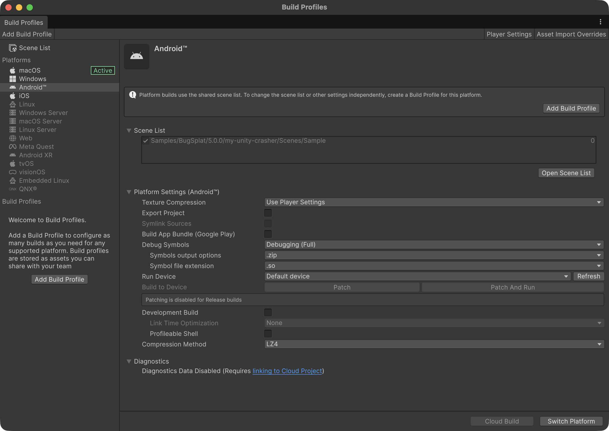

[&larr; BugSplat for Unity](../README.md)

# 🤖 Android

Native Android crash reporting comes from [bugsplat-native](native.md): Crashpad's at-crash handler, shipped as `libBugSplatMonitor.so`, is executed when a native crash happens and writes the minidump; the report uploads through the SDK on the next launch, without a dialog.

Configure the scripting backend to **IL2CPP**, target **ARM64**, and set the Minimum API Level to **Android 8.0 (API level 26)** or higher. `UseNativeCrashReporting` is on by default.

When you build your app for Android, enable `UploadDebugSymbolsForAndroid` and set **Debug Symbols** to **Full** in the Android build settings, so Unity writes a `*.symbols.zip` next to the APK or AAB; that archive is what BugSplat uploads. **Full** carries file and line information, while **Public** carries function names only. **Symbol file extension** can be either setting: BugSplat renames Unity 6's `libil2cpp.so.dbg` and `libil2cpp.so.sym` files to `libil2cpp.so`, the module name crashes report, before uploading.

For IL2CPP builds, BugSplat also uploads Unity's `LineNumberMappings.json`, as `LineNumberMappings-android.json`, so native crash reports map IL2CPP-generated C++ frames back to C# method names, file names, and line numbers. The name keeps an Android build from overwriting the mappings of another platform's build that shares its version. BugSplat reads the file from the `<name>_BackUpThisFolder_ButDontShipItWithYourGame/il2cppOutput/Symbols/` folder Unity writes next to the APK or AAB, falling back to `Library/Bee/artifacts/Android/il2cppOutput/cpp/Symbols/`, and leaves it as it is. Unity only writes it when **Edit > Project Settings > Player > Other Settings > IL2CPP Stacktrace Information** is set to **Method Name, File Name, and Line Number**; without it, the build log warns and names the setting. The mappings only help when `libil2cpp.so`'s symbols carry file and line information, so set **Debug Symbols** to **Full**: with **Public**, the build log warns that C# line numbers will be missing.

With **Export Project** enabled nothing is uploaded, since the symbols archive doesn't exist until you build the exported project. The mappings are in the exported project at `unityLibrary/src/main/Il2CppOutputProject/Source/il2cppOutput/Symbols/LineNumberMappings.json`; to upload them yourself, rename that file to `LineNumberMappings-android.json` and upload it with `symbol-upload` 11.2.0 or later.

## Attachments

Paths listed in `BugSplatOptions.PersistentDataFileAttachmentPaths` are resolved against `Application.persistentDataPath` and registered with the native reporter at startup; `AttachNativeLogFile` and `DetachNativeLogFile` work at any point in the session. Files are copied into the report at crash time.

Unity does not write a `Player.log` on Android — log output goes to logcat and `Application.consoleLogPath` is empty — so `CapturePlayerLog` has no effect on Android reports.

## Hang detection and ANRs

Set `HangDetectionTimeoutMs` to have the SDK's watchdog report a stalled Unity main thread (the heartbeat BugSplat sends every frame stops). Application Not Responding events raised by the OS are imported on the next launch on Android 11 (API level 30) and higher.

## Symbols

`UploadDebugSymbolsForAndroid` uploads the `.so` files from Unity's `symbols.zip` as Breakpad `.sym` files (`symbol-upload --dumpSyms`). It is skipped when **Export Project** is enabled or **Debug Symbols** is **None**. See [Symbol Upload](symbol-upload.md) for credentials.
