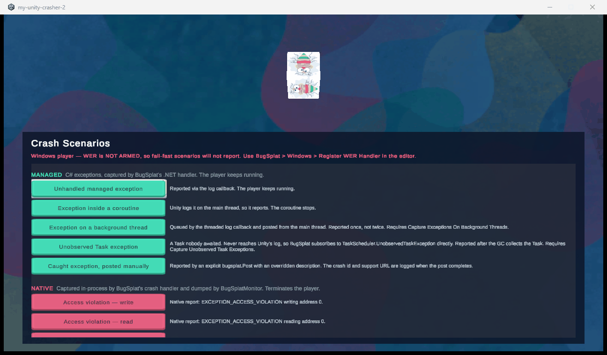

[&larr; BugSplat for Unity](../README.md)

# 🪟 Windows

Native Windows crash reporting comes from [bugsplat-native](native.md): an out-of-process `BugSplatMonitor.exe` built on Crashpad captures the crash and writes the dump while the player is frozen, `BugSplatReporter.exe` shows the BugSplat dialog and uploads, and `BugSplatWer.dll` covers the fail-fast crashes that bypass every in-process handler. It works with both the **Mono** and **IL2CPP** scripting backends. The x64 runtime ships in this package; x86 and ARM64 players are populated from a bugsplat-native release with `Tools~/fetch-native-runtime.ps1`.

`UseNativeCrashReporting` is on by default on your `BugSplatOptions` asset. When it is on:

- Native crashes are captured at crash time and uploaded immediately. Reports that can't be uploaded (for example, when the user is offline) are uploaded automatically on the next launch.
- `Player.log` is attached to native crash reports when `CapturePlayerLog` is enabled. Setting the `CapturePlayerLog` property at runtime adds or removes the attachment.
- The BugSplat crash dialog is shown by default (`UploadPolicy.Dialog`). Choose `Quiet` to send reports silently, or call `bugsplat.SetCrashDialogEnabled(false)` at runtime.
- At build time, BugSplat copies `BugSplatMonitor.exe`, `BugSplatReporter.exe` and the `theme/` folder next to your game's executable, and `BugSplatWer.dll` next to `BugSplat.dll` under `<Game>_Data/Plugins/x86_64/`. These files are required for crash reporting and must be shipped with your game.
- Fail-fast crashes — stack buffer overruns and `__fastfail` — bypass every in-process crash handler and need one extra install-time step. See [Windows Error Reporting](#windows-error-reporting). Heap corruption (`0xC0000374`) is caught in process by bugsplat-native's vectored handler and needs nothing extra.
- Managed exceptions post through the same SDK as structured reports; see [Native crash reporting](native.md).

The native library is a standard `/MD` binary and depends on the Microsoft Visual C++ Redistributable (`vcruntime140.dll`, `msvcp140.dll`), which Unity Windows players already require. If the redistributable is missing on an end user's machine, native crash reporting fails to initialize with an error in the log, and .NET exception reporting continues to work.

## Crash Dialog

The dialog reads its colors, fonts, layout, logo and wording at run time from the `theme` folder next to `BugSplatReporter.exe` — `theme.json`, an optional logo, and one `strings.<language>.json` file per language. Nothing is compiled, so rebranding it means editing files, not rebuilding the SDK. [Crash Dialog Branding](https://docs.bugsplat.com/education/how-tos/customize-the-crash-dialog) documents the theme format.

The Unity package doesn't have a setting for a custom theme yet: every Windows build copies the default theme from the package over the build folder's `theme`. To ship your own, put your theme in that folder in your installer, after the build.

## Heap dumps

Set `DumpType` to `Heap` to include the managed heaps in the dump, so Mono and IL2CPP objects resolve in the debugger, or `Full` for every readable region. The dump is written by DbgHelp while the player is suspended, exactly as Visual Studio and WinDbg expect. Larger dumps take longer to upload and are subject to your database's size limit; the SDK does not gate them client-side.

## Hang detection

Set `HangDetectionTimeoutMs` on the options asset (it is `0`, disabled, by default). BugSplat sends a heartbeat every frame; when it stops for longer than the timeout, `BugSplatMonitor` dumps the live process and uploads a hang report. With `HangPolicy.Report` the game continues once the main thread responds again; with `ReportAndTerminate` the dialog offers Wait / Close and terminates the game on Close. Choose a timeout longer than your longest expected frame — long frames such as loading screens are otherwise reported as hangs.

## Symbols

The post-build step uploads `.pdb`, `.dll` and `.exe` files from your build folder when `UploadDebugSymbolsForWindows` is set. See [Symbol Upload](symbol-upload.md) for credentials.

Windows symbols are uploaded only when **Copy PDB files** is on in **File > Build Profiles > Windows**; without it the build contains no `.pdb` files, so BugSplat skips the upload. If `UploadDebugSymbolsForWindows` is on and Copy PDB files is off, the build log warns as soon as the build starts, and **Edit > Project Settings > BugSplat** shows the same warning with a button that turns the setting on. Only a Windows editor can read the setting.

For IL2CPP builds, BugSplat will also upload `LineNumberMappings.json`. Line mappings allow BugSplat to replace generated C++ function names, file names, and line numbers with their original C# equivalents. Unity only generates the file when **Edit > Project Settings > Player > Other Settings > IL2CPP Stacktrace Information** is set to **Method Name, File Name, and Line Number**; without it, the build log warns and names the setting.

For CoreCLR builds (Unity 7), BugSplat also uploads your scripts' PDBs, so C# frames in native crash reports show file names and line numbers. Unity only puts those PDBs in the build when **Edit > Project Settings > Player > Other Settings > Managed Stack Trace Information** is **Method Name, File Name, and Line Number**, so BugSplat reads each script assembly's PDB from `Library/Bee`, where the compiler wrote it. They're uploaded at either setting, and nothing extra ships with your game.

Unity has moved `LineNumberMappings.json` between versions, so BugSplat searches for it: first in the player's `<Game>_BackUpThisFolder_ButDontShipItWithYourGame` folder, then in the Windows folders under `Library/Bee/artifacts`, taking the newest. If your build puts it somewhere else, set `WindowsLineNumberMappingsPath` to the file, or to the folder holding it. A relative path is relative to the project folder. If nothing is there, the build log warns and BugSplat searches as usual.

Uploads that stall are stopped after `SymbolUploadTimeoutMinutes` (30 by default), and `FailBuildOnSymbolUploadError` makes a failed upload fail the build. See [Timeouts and Failures](symbol-upload.md#timeouts-and-failures).

## Windows Error Reporting

Stack buffer overruns (`0xC0000409`) and `__fastfail` terminate the process through Windows Error Reporting without ever unwinding to an exception filter, so no in-process handler can see them. Windows hands them to `BugSplatWer.dll` instead — but only when the DLL's full path is named by a `REG_DWORD` value under `HKLM\SOFTWARE\Microsoft\Windows\Windows Error Reporting\RuntimeExceptionHelperModules`, which lives in HKLM and needs administrator rights to write. Your installer should add that value at install time and remove it on uninstall:

```
reg add "HKLM\SOFTWARE\Microsoft\Windows\Windows Error Reporting\RuntimeExceptionHelperModules" /v "C:\Path\To\Game\Game_Data\Plugins\x86_64\BugSplatWer.dll" /t REG_DWORD /d 0
```

The value name must match the installed path exactly, using backslashes. Moving or reinstalling the game to a different folder silently disarms it.

For local builds, use **Tools > BugSplat > Windows > Register WER Handler** in the editor. It asks for the `BugSplatWer.dll` under your build's `<Game>_Data/Plugins` folder, writes the value elevated, and reads it back to confirm. **Check WER Handler Registration** reports the current state.



At runtime, `bugsplat.WindowsWerEnabled` tells you whether the handler registered. When it hasn't, BugSplat logs what will be missed and how to fix it — as a warning in development builds and an informational message otherwise, since end users can't act on it. All other crashes are reported normally either way.

If registration appears to succeed but `WindowsWerEnabled` stays `false`, check your endpoint-protection software: `RuntimeExceptionHelperModules` is a known persistence location and some products monitor or block writes to it.
